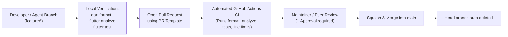

# 🛡️ GitHub Repository Rules, Branch Protection & Maintenance Guide

This document defines the governance rules, branch protection settings, and maintenance workflows for the public `my-gym-tracker` repository.

---

## 🔒 1. GitHub Branch Protection Rules for `main`

To prevent accidental breaking changes and guarantee that every commit on `main` is production-ready, configure the following branch protection settings on GitHub:

### Navigation:
> **Repository Settings** $\rightarrow$ **Branches** $\rightarrow$ **Add branch protection rule** (or edit rule for `main`).

### Recommended Settings Checklist:

| Setting | Value | Why |
|---|:---:|---|
| **Branch name pattern** | `main` | Protects the production integration branch. |
| **Require a pull request before merging** | ✅ Enabled | Disallows direct pushes to `main`. All changes must go through a PR. |
| **Require approvals** | ✅ `1` | Ensures at least one peer or human maintainer reviews the changes. |
| **Dismiss stale pull request approvals when new commits are pushed** | ✅ Enabled | Prevents stealthy unreviewed changes from being merged. |
| **Require status checks to pass before merging** | ✅ Enabled | Blocks merging if CI fails. |
| **Status checks that are required** | `validate` | Must pass the GitHub Actions CI workflow (linting, tests, line limits). |
| **Require branches to be up to date before merging** | ✅ Enabled | Eliminates merge conflict surprises by ensuring CI runs against the latest `main`. |
| **Require conversation resolution before merging** | ✅ Enabled | Ensures all review comments are addressed. |
| **Require signed commits** | ⚙️ Optional | Recommended for cryptographic verification of commits. |
| **Require linear history** | ✅ Enabled | Prevents spaghetti merge graphs (enforces Squash & Merge or Rebase). |
| **Do not allow bypassing the above settings** | ✅ Enabled | Applies to repository administrators as well. |
| **Allow force pushes** | ❌ Disabled | Prevents history rewrites on `main`. |
| **Allow deletions** | ❌ Disabled | Protects `main` from accidental deletion. |

---

## 🔀 2. Pull Request Merge Strategy

In **Repository Settings** $\rightarrow$ **General** $\rightarrow$ **Pull Requests**:

1. **Allowed merge strategies**:
   - ✅ **Allow squash merging** (*Recommended* — creates one clean, descriptive commit per PR matching Conventional Commits).
   - ✅ **Allow rebase merging** (Alternative for fine-grained atomic commit histories).
   - ❌ **Allow merge commits** (Disable to keep git history clean and linear).
2. **Automatically delete head branches**:
   - ✅ **Enabled** — Automatically deletes feature branches (e.g. `feature/exercise-database-enrichment`) once merged, keeping the repository clean.

---

## 🔐 3. Security & Dependency Governance

In **Repository Settings** $\rightarrow$ **Code security and analysis**:

1. **Dependency graph**: ✅ Enabled.
2. **Dependabot alerts**: ✅ Enabled (Free for public repositories — alerts whenever a dependency in `pubspec.lock` has a known CVE).
3. **Dependabot security updates**: ✅ Enabled (Automatically opens automated PRs to patch vulnerable packages).
4. **Secret scanning**: ✅ Enabled (Detects if API keys, tokens, or private credentials are ever accidentally committed and blocks the push).

---

## 🌿 4. Branch Naming & Contribution Flow

Contributors (human or AI) must follow these branch conventions:

```bash
feature/<short-name>   # New features (e.g., feature/video-guidance-ui)
fix/<short-name>       # Bug fixes (e.g., fix/tts-bluetooth-audio)
refactor/<short-name>  # Architectural cleanup (e.g., refactor/exercise-bloc)
test/<short-name>      # Test additions/improvements
docs/<short-name>      # Documentation updates
chore/<short-name>     # Dependency updates, CI tooling
```

### Pull Request Lifecycle:


---

## 📦 5. Versioning & Release Workflow

Follow [Semantic Versioning 2.0.0](https://semver.org/) (`MAJOR.MINOR.PATCH`):

- **PATCH** (`0.1.1`): Backwards-compatible bug fixes.
- **MINOR** (`0.2.0`): New features, backward-compatible schema migrations (e.g. new columns, new seed exercises).
- **MAJOR** (`1.0.0`): Breaking architectural or platform changes.

### Release Tagging:
When a milestone is reached on `main`:
```bash
git checkout main
git pull origin main
git tag -a v1.0.0 -m "Release v1.0.0: Biomechanical Exercise Library & Voice Tracking"
git push origin v1.0.0
```

---

## 🛠️ 6. Routine Repository Maintenance Checklist

Perform monthly or on major Flutter updates:

1. **Dependency Audit:**
   ```bash
   flutter pub outdated
   flutter pub upgrade --major-versions
   ```
2. **Codebase Line Bounds Check:**
   Ensure no file in `lib/` exceeds **250 lines** and no widget exceeds **80 lines**.
3. **Database Migration Verification:**
   Whenever adding new Drift tables or columns:
   - Increment `schemaVersion` in `lib/data/database/app_database.dart`.
   - Implement `onUpgrade` with both DDL (`addColumn`) and batch data seeding (`InsertMode.insertOrReplace`).
   - Add a test in `test/data/database/app_database_test.dart` verifying migration from previous version.
